<a href="https://subunit.ai">
<picture><source media="(prefers-color-scheme: dark)" srcset="assets/banner-dark.svg"></picture>
</a>

### Hi, I'm Tom.

I build AI systems that companies actually run on: agentic workspaces, voice-to-text and knowledge infrastructure.
Managing Director of **[Subunit](https://github.com/Subunit-UG)**, based in Teltow near Berlin.

Most of my work lives in private repositories at [Subunit-UG](https://github.com/Subunit-UG). This page is the window into it.

### What I'm building

<a href="https://subunit.ai/produkte/subunit-os/"><picture><source media="(prefers-color-scheme: dark)" srcset="assets/card-1-dark.svg"></picture></a>
<a href="https://subunit.ai/echo/"><picture><source media="(prefers-color-scheme: dark)" srcset="assets/card-2-dark.svg"></picture></a>
<a href="https://subunit.ai/produkte/"><picture><source media="(prefers-color-scheme: dark)" srcset="assets/card-3-dark.svg"></picture></a>

### Stack

<picture><source media="(prefers-color-scheme: dark)" srcset="assets/stack-dark.svg"></picture>

### How I work

- **Complete or not at all.** A feature ships with every piece wired, deployed and tested, or it doesn't ship.
- **Proof over claims.** Every release passes an independent review gate before it goes live.
- **Humans decide, agents build.** I set direction and review; a team of AI agents does the heavy lifting.

### Get in touch

[subunit.ai](https://subunit.ai) · [Contact](https://subunit.ai/kontakt/) · [info@subunit.ai](mailto:info@subunit.ai)

Made in Germany · Subunit UG (haftungsbeschränkt)
